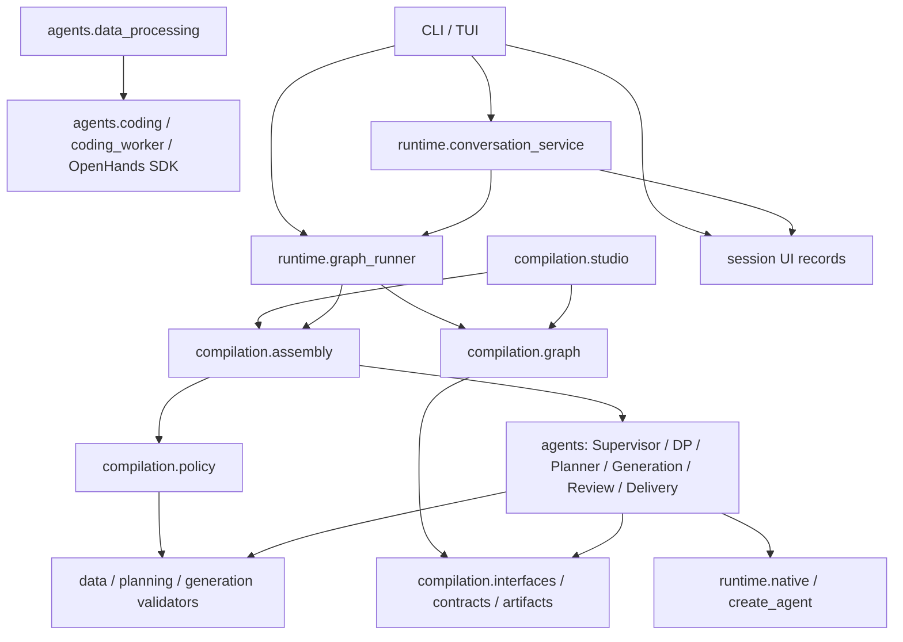
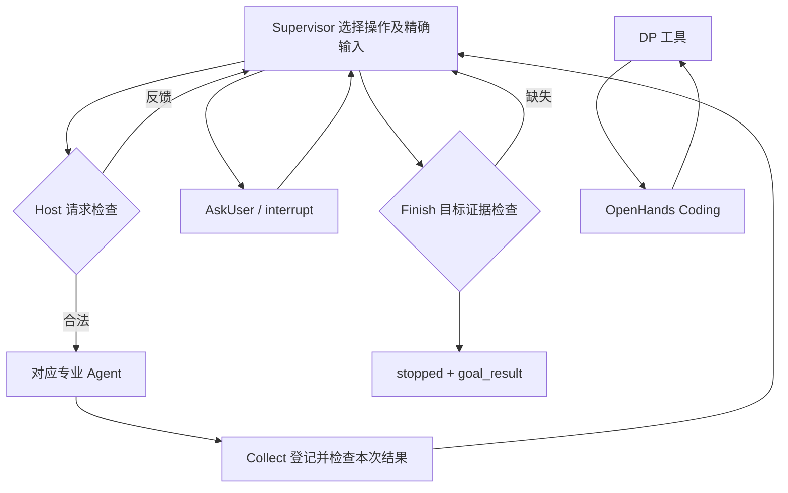
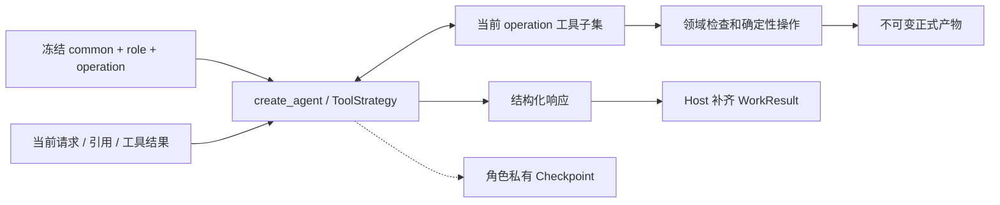

# MedD2B Compilation 架构

当前只有 Compilation 正式执行链。推荐协作路径写在冻结的角色/操作 Prompt 中；外层图负责
工作交接和确定性检查，不维护全局业务阶段。实现记录见 [PLAN](PLAN.md)。

## 模块依赖（箭头表示代码依赖）

Policy 是 Assembly 注入的请求、结果与目标检查函数，领域语义仍由 Reader、规划及生成模块检查。
Supervisor 实现位于 agents.supervisor；Coding 适配器与子进程也归属 agents，由 Assembly 注入 DP。
Graph 不导入领域实现或 SDK。实验记录不是第二个执行账本；standalone RAG、图像转换与几何函数
是保留的库能力，不是额外 Agent。旧 Workflow/BIR/Resolver/Harness/Preparation 编排已移除。

## 运行交接（箭头表示实际调用）

正常工作顺序：Profile → 场景/backend/需求 → TaskData → 验收/Leaf → 组题 → Review/Audit → Delivery。
这是依赖形成的协作路径；每次结束均回到 Supervisor。修复只委派所需对象，保留无关有效产物。

## Agent 内部结构

DP 与 Planner 分别具有两个 operation；工具边界由代码检查，状态推进由真实回执决定。
DP、Planner、Generation、Review 接收按 operation 索引的冻结指令；Supervisor 与 Coding 接收组合文本。
Coding 仅接受 DP 内部 execute 请求并返回候选；DP 检查后提交。Allocation、Audit、Delivery
没有模型循环。摘要不承担业务事实来源，来源正文不拼入静态系统指令。

## 状态归属

| 所有者 | 内容与位置 |
| --- | --- |
| Run | run.json：目标类型、数量、配置、修复限额、Prompt 组合和实现指纹 |
| 父图 | 请求/结果、正式引用、用户答案、反馈、少量修复/无进展计数 |
| 专业 Agent | 私有消息、当前 operation、草稿/提交引用、请求临时状态 |
| DP / SDK | DP 拥有 Coding 会话与调用身份；SDK 保存自己的对话和执行记录 |
| 正式产物 | Profile、TaskPlan、需求、TaskData、Spec、批次、候选、审查及 Delivery |
| UI 实验 | 运行目录索引、界面消息、待用于新运行的配置；状态由 Checkpoint 查询 |
| 日志 | events.jsonl 及 SDK 日志，用于诊断，不作为恢复事实 |

CLI 使用 SQLite；Studio 使用平台注入的 Checkpointer。一目录一运行，Studio 另绑定单一线程。
恢复使用冻结指令，代码/工具/契约指纹不匹配时拒绝恢复。配置和凭据入口保持分离。
Supervisor/Planner 固定为原生模型实现，Coding 固定使用 OpenHands；Run 不保存单值实现选择器。
专业角色启停仍由 Run 冻结，测试替身通过模型和执行器注入。
