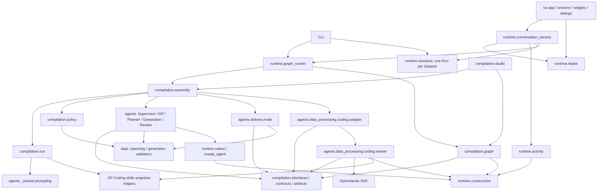
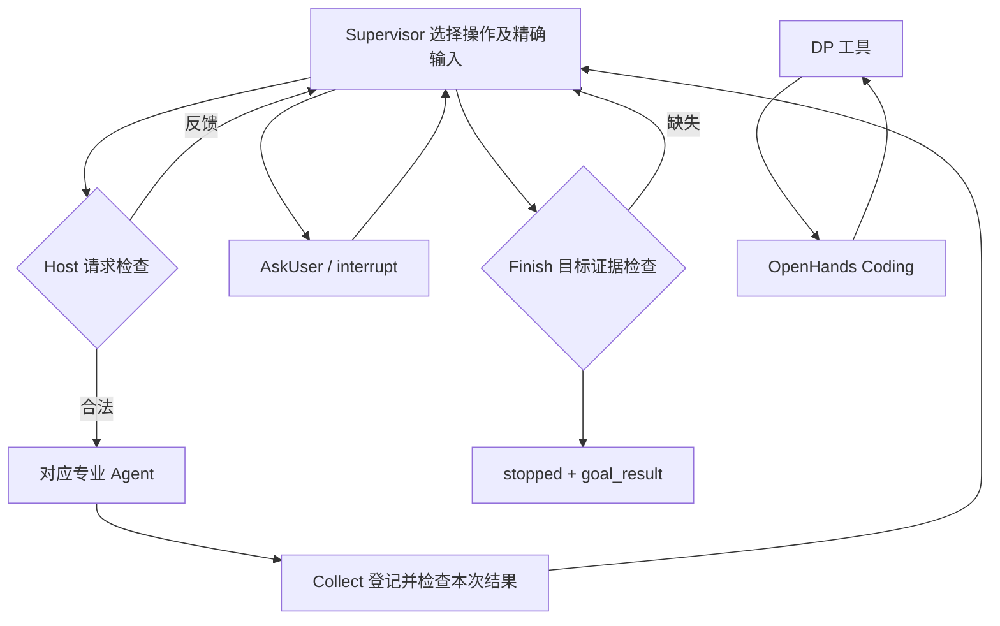
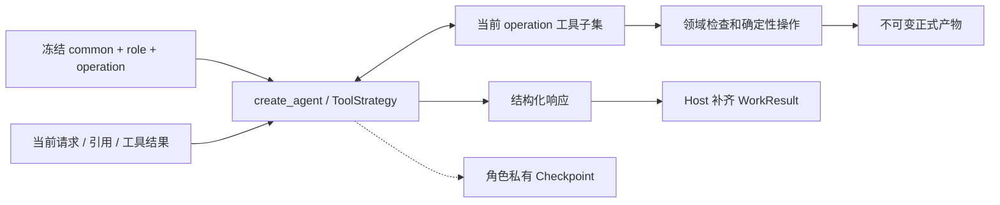

# MedD2B Compilation 架构

当前只有 Compilation 正式执行链。推荐协作路径写在冻结的角色/操作 Prompt 中；外层图负责
工作交接和确定性检查，不维护全局业务阶段。实现记录见 [PLAN](PLAN.md)。

## 模块依赖（箭头表示代码依赖）

Policy 是 Assembly 注入的请求、结果与目标检查函数，领域语义仍由 Reader、规划及生成模块检查。
Supervisor 实现位于 agents.supervisor.agent；Coding 适配器与子进程也归属 agents，由 Assembly 注入 DP。
DP 通过注入的适配器调用 Coding，不导入其私有实现；下图单独表示运行时交接。
Graph 不导入领域实现或 SDK。Run 的 UI 记录不是第二个执行账本；standalone RAG、图像转换与几何函数
是保留的库能力，不是额外 Agent。旧 Workflow/BIR/Resolver/Harness/Preparation 编排已移除。
Intake 仅把用户草稿与目录/关键文件适配成当前输入契约；连接向导复用模型发现和 Coding 环境检查。
Activity 是诊断事件的增量读取与展示投影，不参与委派、结果验收或恢复。

## 运行交接（箭头表示实际调用）

正常工作顺序：Profile → 场景/backend/需求 → TaskData → 验收/Leaf → 组题 → Review/Audit → Delivery。
这是依赖形成的协作路径；每次结束均回到 Supervisor。修复只委派所需对象，保留无关有效产物。

各角色以包组织：agent.py 装配模型循环，tools.py 暴露工具；DP/Planner 的 state.py 持有角色私有状态与辅助逻辑。
共享交接与 Prompt 组合位于 agents._shared；角色/操作 Markdown 随角色打包。Coding 是 DP 内部子包。

## Agent 内部结构

DP 与 Planner 分别具有两个 operation；工具边界由代码检查，状态推进由真实回执决定。
DP、Planner、Generation、Review 接收按 operation 索引的冻结指令；Supervisor 与 Coding 接收组合文本。
Coding 仅接受 DP 内部 execute 请求并返回候选；DP 检查后提交。Allocation、Audit、Delivery
没有模型循环。摘要不承担业务事实来源，来源正文不拼入静态系统指令。
Coding 的 AgentContext 使用 Run 冻结的包内 Skill 集合，由 SDK 原生 InvokeSkillTool 按需调用。
Skill 正文与随附资源只保存在运行目录，SDK 加载时核对名称和摘要；不读取来源数据中的 Skill 指令。

## 状态归属

| 所有者 | 内容与位置 |
| --- | --- |
| Run 数据目录 | runs/name 下 config.toml、冻结 run.json（含 runtime_directory）、inputs 和 artifacts；保存可追溯定义与正式数据 |
| Run 运行目录 | .runtime/runs/compilation_id 下 checkpoints.sqlite、locks、planner 草稿、resources/coding-skills 和 coding/workstream_id |
| 父图 | 请求/结果、正式引用、用户答案、反馈、paused/waiting/stopped 及少量修复/无进展计数 |
| 专业 Agent | 私有消息、当前 operation、草稿/提交引用、请求临时状态 |
| DP / SDK | DP 拥有 Coding 会话与调用身份；SDK 保存自己的对话和执行记录 |
| 正式产物 | Profile、TaskPlan、需求、TaskData、Spec、批次、候选、审查及 Delivery |
| UI Run | 运行目录的 session.json 保存消息/问题回执、输入草稿和位置引用；不保存执行状态，状态由 Checkpoint 查询 |
| UI 内存 | 当前选择、后台执行句柄、暂停请求、活动字节游标与有界缓存；不作为恢复事实 |
| 日志 | events.jsonl 及 SDK 日志，用于诊断，不作为恢复事实 |

一个命名 Run 对应一个 Dataset 和一次 Compilation；数据目录与运行目录必须互不重叠。
CompilationContext、专业 Agent 上下文显式注入 directory 与 runtime_directory，ArtifactRef 仍相对数据目录。
CLI 使用运行目录中的 SQLite；Studio 使用平台注入的 Checkpointer，线程绑定文件归运行目录。
恢复使用冻结指令，代码/工具/契约指纹不匹配时拒绝恢复。配置和凭据入口保持分离。
Supervisor/Planner 固定为原生模型实现，Coding 固定使用 OpenHands；Run 不保存单值实现选择器。
启用角色由目标与输入类型决定，冻结配置的存在性是唯一装配依据；测试替身通过模型和执行器注入。
Profile 只启用 Supervisor/DP/Coding；Scenario Plan 在 Canonical 输入下只需 Supervisor/Planner，原始输入增加 DP/Coding。
Executable Leaf Plan 使用 Supervisor/DP/Coding/Planner；Benchmark 才启用 Generation/Review/Delivery。
对象级就绪建议由 Policy 临时计算并复用请求检查，Supervisor 分页查询；它不保存第二套状态或自动调度工作。

## TUI 生命周期与活动

TUI 启动进入 Run 列表，不自动创建默认实验；创建、复制、配置与执行沿用 sessions/intake/graph_runner。
InputDraft 保存到运行目录，首次执行时自动冻结 SourceManifest 与配置，再调用 create_run/Assembly/Graph。
后续恢复不读取可变配置；复制仅复制配置和数据选择，不复制 Checkpoint、会话或产物。
LangChain 模型 callbacks、工具 middleware 与 SDK/provider callbacks 向运行目录的 events.jsonl 写入诊断。
模型事件记录实际 usage（含摘要调用），缺失时明确标记；工具任意正文只保留结构摘要，不复制 Prompt 或推理内容。
Coding 回执关联父 DP request，stdout 仍只用于候选协议。TUI 在后台约每 250ms 增量读取诊断事件。

暂停先保留内存请求，直到父图节点保存后用原生 update_state 写入 paused 并保留 next。
已有 interrupt 或终止状态优先；回答通过 Command(resume=...) 消费，UI 使用 interrupt ID 防止回答过期问题。
运行锁表示活动执行器；未结束但没有锁的运行显示为异常中断。日志不能把运行标为成功或驱动恢复。
界面区分工作完成、Review 拒绝和最终目标失败；修复计数、无进展算法与角色循环未改写。

## 数据发布与本地工作区

Coding 子进程只接受正式输入引用，按 Workstream 保存 workspace/conversations/logs；候选必须位于
当前请求 outputs 目录。Host 验证引用、真实路径、摘要及领域契约后发布。TaskData 沿用完整快照；
Profile 将运行目录中的派生成员固化到正式产物，原始来源仍可外部引用。正式派生文件不依赖 .runtime。
本地模式具有宿主用户权限，不提供文件系统只读隔离。本轮无 Docker，也没有新增通用执行后端。
静态行为边界仍归包内 Prompt；动态工作区位置由适配器装配。
