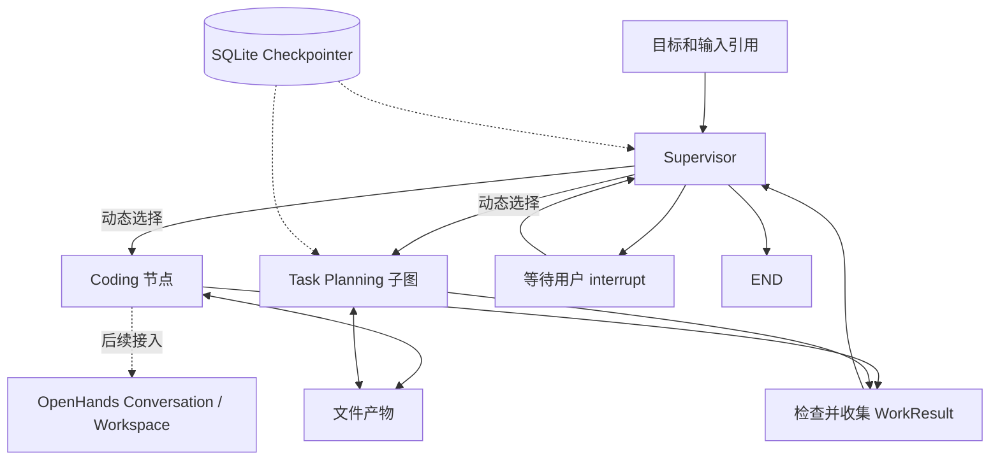

# MedD2B Compilation

## 实施状态与范围

本分支独立重建 Agentic Benchmark Compiler 的协作骨架。本文固定目标边界；
首期骨架、更名和模型 Supervisor 适配已实现；在线验收状态见 [PLAN](PLAN.md)。
专业 Agent 仍为合成示例，不代表三个真实 Agent
或医学 Benchmark 编译已经验证。

旧 Workflow、Preparation Graph、Resolver、BIRStore 和通用 harness 是参考资产。
Compilation 不导入它们，也不通过兼容层执行原流水线。OpenHands、完整
Task Planning、Generation、Review、Audit 随后按能力迁入。

## 调用方式

使用原生 LangGraph StateGraph：Supervisor 集中决策、具名专业节点串行执行、
结果返回 Supervisor。注册表在构图时装配节点，运行时每次选择一个目标。
图不包含 Coding → Planner 或其他固定业务阶段连线。

Agent-as-Tool 与具名节点都是官方支持的组合。工具适合对话式委派；
这里使用具名节点，以保持明确交接和可检查的子图状态。这是官方 Custom Workflow
原语的组合，不是新的 Agent Runtime。

参考：[Multi-agent](https://docs.langchain.com/oss/python/langchain/multi-agent)、
[Subagents](https://docs.langchain.com/oss/python/langchain/multi-agent/subagents)、
[Subgraphs](https://docs.langchain.com/oss/python/langgraph/use-subgraphs)、
[Graph API](https://docs.langchain.com/oss/python/langgraph/graph-api)。

## 状态所有权

| 所有者 | 内容 | 持久化 |
| --- | --- | --- |
| Supervisor | 目标、请求、结果摘要、产物引用、协调进度 | 父图 SQLite checkpoint |
| Planner | 私有探索上下文、草稿游标、待满足需求 | per-thread 子图，checkpointer=True |
| Coding 适配节点 | 本次请求、结果及必要会话引用 | 父图交接记录 |
| OpenHands（后续） | Conversation、工具事件、脚本和 Workspace | SDK 与工作区 |
| 一次性专业子图 | 单次调用内状态 | per-invocation，默认 checkpointer=None |
| 文件产物 | 其他 Agent 可读取的业务内容 | Compilation 目录 |

每个 Compilation 使用稳定 thread_id。子图直接注册具名节点，由 LangGraph 管理
namespace；不手工拼接，也不依赖 dispatcher 内隐式调用顺序。None 表示单次调用
继承 checkpoint，False 才表示禁用。不得统一强制所有 Agent 使用 True。

父子图仅交接 request、result，不共享完整 messages。输入输出 schema 隔离私有字段。
决策函数、客户端、文件服务通过 Runtime context 注入，不序列化。
不另存 Agent state.json，不在 LangGraph 中复制 OpenHands 完整状态。

## 工作契约

- ArtifactRef：artifact_id、kind、path（相对 Compilation 根目录）。
- WorkRequest：request_id、compilation_id、agent_id、objective、scope、inputs、constraints。
- WorkResult：request_id、outcome、summary、artifacts、issues、needs。
- outcome：completed、progress、needs_input、blocked、failed。
- needs：需求标识、work/user 类型、说明及可选 detail_ref。

Host 在执行前分配并 checkpoint 请求；恢复沿用标识，新输入形成新请求。
scope 是业务标识列表，Compilation 不解释临床语义。结果关联当前请求，输出文件必须存在。
已交接文件不原地修订。completed 只表示本次工作完成，不等于 Benchmark 已交付。
work 需求返回 Supervisor，不触发 interrupt；只有等待用户时暂停父图。
专业工作 failed/blocked 也返回 Supervisor，由其决定下一步。

## 文件与恢复

首期仅需 checkpoints.sqlite 和 artifacts/<request_id>/ 文件。
独立入口保存 run.json，记录初始模式、目标、示例选项和不含凭据的模型配置；
恢复读取原始记录，不重新选择模式或模型。旧演示运行不增加兼容读取。
使用 SqliteSaver 与 durability="sync"。已 checkpoint 的工作续接时复用；
未完成节点可能重放，示例文件写入因此使用稳定请求路径和幂等的相同内容写入。
不承诺任意外部命令在崩溃窗口内 exactly-once。

等待用户使用同一 thread_id 的 Command(resume=...)；普通未完成执行用 None 续接；
已结束线程不是待恢复工作。首期不引入提交账本、队列、版本发布或依赖失效引擎。
BIR 将来只负责业务语义与产物关系；首期不实例化 BIRStore 或复制协调状态。
Dataset revision/file_digest 继续表达输入身份，不成为 Artifact 版本体系。

## 模块边界

- compilation：契约、图装配、结果检查、文件交接、Supervisor 适配及独立入口。
- data：Case/Evidence/Asset、Dataset Manifest、Reader；不依赖 Agent。
- planning/contracts：DataRequirement、SemanticTaskSpec；不含 Resolver。
- 专业 Agent/示例：可使用 Reader 和任务契约，不能相互直接委派。
- runtime.llm 与模型配置：复用客户端和有限结构化修复，不调用旧业务调度。
- 旧 preparation/workflow/harness：后续选择性抽取，不是 Compilation 的依赖。

## 接入接口

build_compilation_graph(agents, checkpointer=...) 接收 Agent 名称到 AgentSpec(description, node)
的映射。node 是普通节点函数或已编译子图。节点只接收 AgentInput.request，返回
AgentOutput.result；有私有字段的子图必须设置这两个窄 input_schema/output_schema。

CompilationContext(directory, decide) 通过 invoke 的 context 注入。decide 接收 SupervisorView，
返回 Delegate、AskUser 或 Finish；View 包含能力描述、已登记引用、最后结果、协调摘要
及用户回答。生产核心不读取演示策略，也不要求所有 Agent 采用同一种持久化。
子图的持久化设置由专业实现自己确定。新增 Agent 只需新增实现和注册项。

结果契约/文件检查失败会以 failed WorkResult 返回 Supervisor。专业实现应把业务失败
表达为 WorkResult；未捕获的程序异常保留 LangGraph 的失败 checkpoint，供修复后续接。

## 模型 Supervisor 与运行方式

ModelSupervisor 实现相同的 decide(SupervisorView) 接口，返回 Delegate、AskUser 或 Finish，
不改变 Graph、工作契约和专业 Agent 的持久化。提示词描述能力和目标，不规定调用顺序。
模型只选择已登记的 Agent 和产物 ID，由 Host 解析为 ArtifactRef，不接受模型编造路径。
非法选择、结构错误进入已有 complete_validated_json 的有限修正流程。
模型不可用、修正失败或请求超限均明确报错并保留 checkpoint，不回退到 Scripted。

模型接收目标、能力描述、协调摘要、最近结果和少量产物预览。
仅读取最近结果及需求引用的文本/JSON，不递归扫描 Dataset。预览截断、未预览文件和
总请求超限都显式说明。上下文、单文件预览及预览数量上限来自 config 的 supervisor 配置。

入口为 python -m medbenchagent.compilation run/resume；--supervisor scripted|llm 默认
scripted，--config 选择模型配置，--goal 可指定目标。只有 llm 模式加载 llm/supervisor
相关配置和探测 Chat 模型，不预检 RAG、准备或 Generation。
模式和选定模型在开始执行前保存；凭据继续从环境读取，不写入配置快照。
输出分别标明 supervisor_mode 和 agent_mode，后者目前恒为 scripted。
现有 medd2b CLI/TUI 保持原入口，专业能力和最终入口切换仍是后续工作。

详见 [数据契约](DATA_LAYER.md)、[任务契约](TASK_DISCOVERY.md)、[Agent 文档](agents/README.md)。
