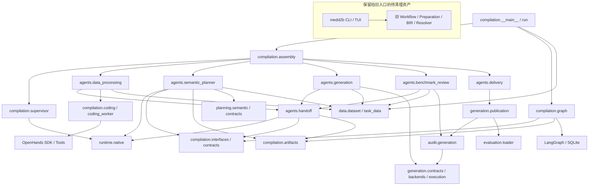
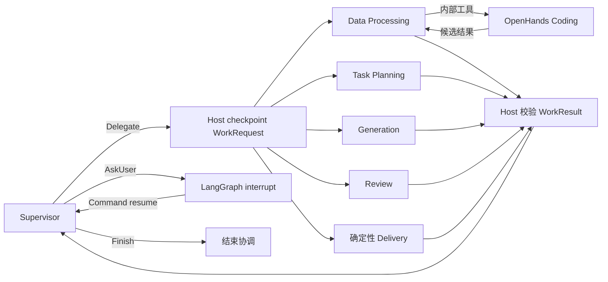
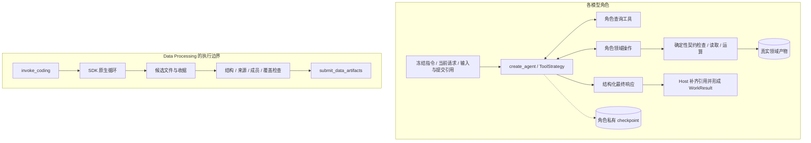

# MedD2B Compilation 架构

本文描述当前模块和状态边界；当前能力与检查记录见 [PLAN](PLAN.md)，协议见
[Agent 文档](agents/README.md)。本轮补齐能力，完整协作 Prompt 和旧架构统一清理留待下一轮。

## 1. 模块与代码依赖

箭头表示 import / 使用依赖，不表示执行顺序。

五个模型角色使用 create_agent。Allocation、Audit、Delivery 为确定性领域能力。
Compilation Graph 不导入专业业务实现；Assembly 根据冻结设置装配。
agents.handoff 仅提供原生状态中的请求结果重置、当前视图和正式引用转换，不实现另一套执行循环、
调度器或状态账本。不同 Agent 不导入其他 Agent 的私有工具和草稿实现。

## 2. 实际运行交接

下图是可用的调用关系，不规定调用次数或业务先后。

Data Processing 拥有内部 Coding Workstream 和 Call 身份，可在一次委派中多次执行、检查和修复。
原独立 Coding 适配保留用于尚未迁移的演示/调用方；启用 Data Processing 时不再向 Supervisor
注册独立 Coding 节点。WorkRequest/WorkResult/ArtifactRef 保持通用交接职责。

## 3. Agent 内部结构

专业 Agent 选择操作并作领域判断；工具不隐藏额外的语义模型循环。
Profile 可独立用于规划；TaskData 按后端组织可共享的 Cases；Leaf 拥有问题组装定义；
GenerationSpec 只保存执行绑定与采样参数。Review 只写自己的判断，Audit 和 Delivery 负责确定性验收。

## 4. 状态所有权

| 所有者 | 保存内容 | 位置 |
| --- | --- | --- |
| Run | 启用角色、模型、限额、Prompt 文本/摘要、数量目标 | run.json |
| Compilation | 请求/结果、正式引用、用户回答；独立 Coding 演示的 Workstream 目录 | 父图 checkpoint |
| 各模型角色 | 私有 messages、摘要、当前请求、领域草稿或已提交引用 | 原生子图 checkpoint |
| Data Processing | 内部 Coding 会话 ID、调用参数和候选文件收据 | 本角色 checkpoint |
| OpenHands | Conversation 消息、工具事件、执行进度 | SDK 持久化目录 |
| Planner | 不可变领域草稿，checkpoint 仅持有引用 | planner/drafts/ |
| Generation | 当前隔离选择；正式配置、批次和候选另存产物 | 私有 checkpoint / artifacts |
| 正式产物 | Profile、TaskPlan、TaskData、执行配置、候选、报告、交付 | artifacts/请求/ |
| Runtime Context | 当前请求、Reader、设置、依赖和本次返回收据 | 调用内，不是持久数据库 |
| 日志 | 模型、工具与交接关联信息 | events.jsonl，不用于恢复决策 |

每次调用重新锚定当前输入；不使用隐式 latest。原生摘要不替代正式领域事实。
同角色入口使用互斥；并行草稿写入被拒绝；SDK 自己管理 Coding 的恢复。
正式文件不可覆盖，Profile/TaskData/候选的成员内容按摘要核验。

本轮只提供基础角色指令、工具说明和产物约束。跨 Agent 的具体协作策略下一轮统一整理，
不把推荐的工作路径写成 Graph 的固定阶段。
