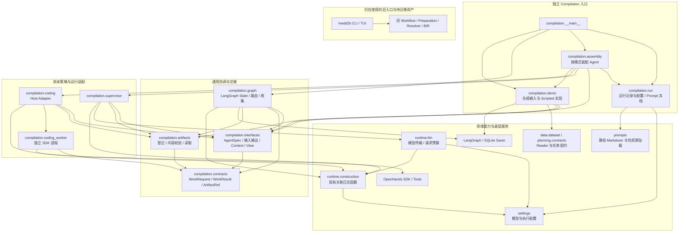
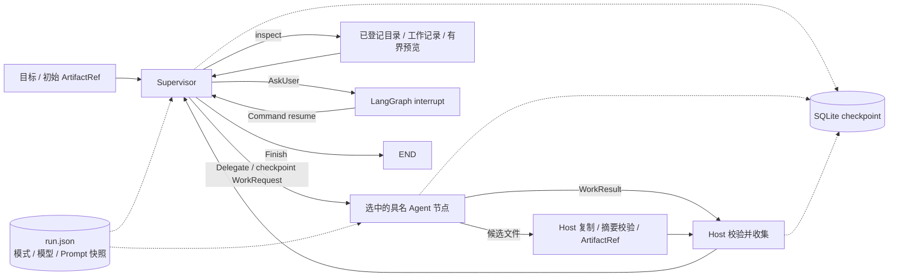
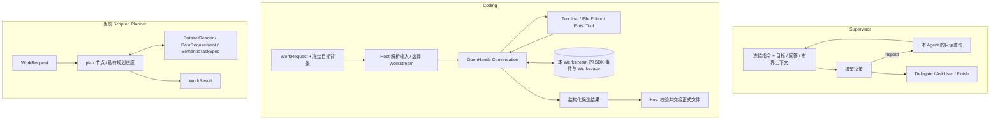

# MedD2B Compilation 架构

本文是模块、依赖和状态归属的入口。图示对应当前实现，施工与验证进度见
[PLAN](PLAN.md)；交接细节见 [Agent 契约](agents/README.md)，命令与配置见 [README](../README.md)。

## 1. 模块与代码依赖

箭头表示主要的 **import / 使用依赖**，不是运行顺序；不穷举纯类型导入。`compilation` 包中的通用协调模块与
具体 Agent 适配分别分组；领域模块不反向依赖 Agent 或协调图。

新 Graph 不导入具体 Agent 或旧业务链。Assembly 只装配已实现的能力，不生成数据；
当前独立 CLI 明确创建合成输入，Planner 仍选用 Scripted 实现。旧入口暂未切换。

## 2. 运行时协作与恢复

箭头表示 **运行时交接或持久化**。Supervisor 每次动态选择一个 Agent；没有固定的
Coding → Planner 业务流水线。内部 inspect 查询只读协调记录与正式产物。

同请求重放沿用请求和 Workstream 身份；新请求可续接同一 Workstream。正式文件按请求
独立保存，修改形成新的交接。Checkpoint 是协调事实来源，日志不用于恢复决策。

## 3. Agent 内部结构

每个 Agent 选择适合自身的普通节点、子图或外部 Runtime；图中只展示当前实现。
Tool 和内部子图归属 Agent，复用的确定性业务能力归属领域模块。

Coding 使用 SDK 原生 Agent Loop，不再套一层子图。Planner 使用原生 per-thread 子图。
真实 Axis/Scenario/Leaf、Generation 与医学 Skill 是后续能力，不是图中已实现组件。

## 4. 状态所有权与扩展规则

| 所有者 | 保存内容 | 位置 |
| --- | --- | --- |
| Run | 初始目标、模式、有效模型/执行参数、静态 Prompt 文本与摘要 | run.json |
| Compilation Graph | 当前交接、可查询请求/结果历史、Workstream 目录、正式引用、用户回答 | SQLite checkpoint |
| Supervisor | 单次决策的有界上下文与只读查询结果 | 调用内临时对象，不另存记忆 |
| Scripted Planner | 私有规划轮次与待满足要求 | LangGraph 子图 checkpoint |
| OpenHands | 每个 Workstream 的消息、工具事件和执行进度 | `coding/<workstream_id>/conversations/` |
| Coding Workspace | 可修改脚本及按请求划分的候选输出 | `coding/<workstream_id>/workspace/` |
| 正式 Artifact | 单个已交接文件及 SHA-256 内容身份 | `artifacts/<request_id>/` + checkpoint 引用 |
| 诊断日志 | 模型调用与执行关联标识 | events.jsonl / Coding 请求日志，不是状态账本 |

新增功能先判断所属层级：跨 Agent 协调进入 Core；专业决策、Tool 包装和内部子图进入
所属 Agent；可复用的读取、运算和生成能力进入领域模块。静态指令进入包资源，动态目标、
约束、证据和 Tool Schema 由对应代码装配。新增文件须有独立职责，不要求每个 Agent
都有相同目录，也不为普通操作建立 Subgraph 或 Manager。

Skill 仅作为 OpenHands Coding 的可选领域扩展，与 Workstream 生命周期独立；本轮不实现
Skill Registry。正式 Artifact 的摘要仅覆盖被引用文件，不递归冻结 Dataset；Local Workspace
不是操作系统沙箱，不承诺外部命令 exactly-once。

详细边界：[Supervisor](agents/supervisor.md)、[Coding](agents/coding.md)、
[Task Planning](agents/task-planning.md)、[数据契约](DATA_LAYER.md)、[任务契约](TASK_DISCOVERY.md)。
