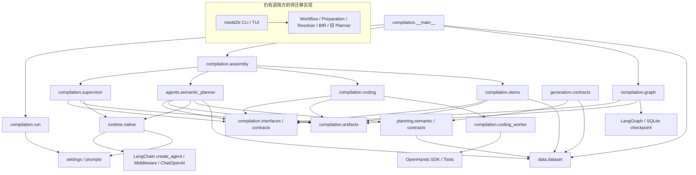
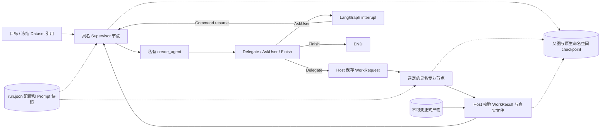
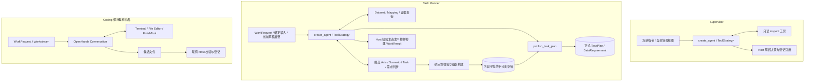

# MedD2B Compilation 架构

本文只描述当前实现。交接与工具协议见 [Agent 文档](agents/README.md)，施工和验证记录见
[PLAN](PLAN.md)。旧 medd2b CLI/TUI 与业务链仍等待迁移。

## 1. 模块与代码依赖

箭头表示 import / 使用依赖，不表示业务执行顺序。

Compilation Graph 只负责协调；专业工具不进入顶层 Graph。原生 Planner 的语义操作归属
planning，数据读取和快照归属 data，模型传输和通用 Middleware 装配归属 runtime.native。
后者没有额外状态库、调度循环或 Agent 基类。Assembly 仅装配启用的能力，不创建输入数据。
真实 Dataset 入口不注册合成 Coding；可显式启用现有 OpenHands。

## 2. 运行时交接与恢复

箭头表示实际调用、交接或持久化；没有固定 Coding → Planner 阶段链。

父图 thread_id 等于 compilation_id；角色通过具名节点继承原生命名空间。Supervisor 与
模型 Planner 使用 checkpointer=True；共享状态不保存它们的 messages、摘要或草稿正文。
同一角色的入口使用本地 FileLock，模型工具配置关闭并行；同一轮多个草稿写工具由代码拒绝。
已完成子节点的结果可以恢复到 collect，不必重跑模型。外部 SDK 执行仍不承诺 exactly-once。

## 3. Agent 内部结构

Axis/Scenario 的语义判断在 Planner 模型内，工具不调用隐藏的领域模型循环。
Task Family 在 Scenario 后选择。Planner 不管理生成模板或 Resolver；GenerationSpec 是
独立执行契约，当前没有生成 Agent 或已接入的新生成后端。
Data Processing 包装、Review、Audit、Delivery 执行链仍是后续工作，未画成已实现节点。

## 4. 状态所有权

| 所有者 | 权威内容 | 保存位置 |
| --- | --- | --- |
| Run | 模式、目标、启用模型/限额、静态 Prompt 文本和摘要 | run.json |
| Compilation | 请求/结果历史、正式引用、用户回答、Workstream 目录 | 父图 SQLite checkpoint |
| Supervisor | 私有消息及原生摘要 | Supervisor 子图 checkpoint |
| Planner | 私有消息、当前请求、草稿引用、本请求已提交引用 | Planner 子图 checkpoint |
| Planner 草稿 | 当前领域判断的不可变文档 | planner/drafts/内容摘要.json |
| 正式 Task Plan | 可交接的任务、证据、需求、接受和排除记录 | artifacts/请求/plans/ |
| Dataset | Manifest、成员摘要及冻结成员文件 | artifacts/输入请求/dataset/ |
| OpenHands | Workstream 内事件、执行进度与可修改 Workspace | coding/Workstream/ |
| Runtime Context | Reader、当前请求、当前视图、配置和服务依赖 | 调用内注入，不持久化 |
| 日志 | 模型调用、工具结果及交接关联标识 | events.jsonl，不参与恢复决策 |

当前视图每次模型调用重新装配，不反复追加完整协调历史。摘要只保留工作上下文；准确的任务、
需求和接受结论从领域文档恢复。输入绑定固定，工具不寻找隐式 latest。ArtifactRef 的摘要覆盖
引用文件；DatasetManifest 的 members 进一步覆盖实际记录、Mapping、资产和被引用来源文件。

静态指令通过包资源加载并冻结。Skill 仍仅是 OpenHands 的可选扩展。只支持当前 canonical
契约和当前代码/冻结配置下的恢复，不增加历史状态迁移或双格式读取。
